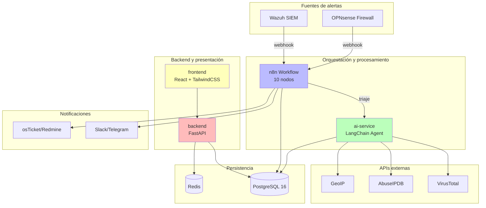

# SistemaTriaje (SOC-Lite)

> Sistema de triaje automático de alertas SOC para PYMEs que combina orquestación low-code (n8n) con razonamiento LLM (LangChain)

[](https://opensource.org/licenses/MIT)
[](https://www.python.org/downloads/)
[](https://reactjs.org/)
[](https://www.typescriptlang.org/)

---

## 📋 Tabla de contenidos

- [El problema](#-el-problema)
- [La solución](#-la-solución)
- [Arquitectura](#-arquitectura)
- [Características principales](#-características-principales)
- [Requisitos](#-requisitos)
- [Instalación rápida](#-instalación-rápida-5-pasos)
- [Uso](#-uso)
- [Roles y permisos](#-roles-y-permisos)
- [Flujo de triaje](#-flujo-de-triaje-n8n)
- [Variables de entorno](#-variables-de-entorno)
- [Documentación](#-documentación)
- [Roadmap](#-roadmap)
- [Licencia](#-licencia)

---

## 🔥 El problema

Los centros de operaciones de seguridad (SOC) de PYMEs enfrentan desafíos críticos:

- **Costo prohibitivo**: Los SOAR comerciales (Cortex XSOAR, Splunk SOAR) cuestan decenas de miles de dólares anuales, inaccesibles para empresas pequeñas y medianas.
- **Fatiga de alertas**: Los SIEMs open source como Wazuh generan cientos de alertas diarias, pero **70-90% son falsos positivos** o de baja relevancia.
- **Falta de contexto**: Las alertas crudas no incluyen enriquecimiento contextual (reputación de IPs, geolocalización, historial de incidentes).
- **Triaje manual lento**: Analistas tardan **horas** en clasificar alertas manualmente, aumentando el MTTT (Mean Time To Triage).
- **Alertas críticas ignoradas**: El volumen abrumador causa que alertas verdaderamente peligrosas pasen desapercibidas.

---

## 💡 La solución

**SistemaTriaje** automatiza el flujo completo de ingesta, enriquecimiento, clasificación y triaje de alertas de seguridad:

1. **Ingesta automática**: Webhook para recibir alertas de Wazuh, OPNsense y otros SIEMs.
2. **Filtrado inteligente**: Elimina duplicados y alertas de baja severidad antes de procesar.
3. **Enriquecimiento contextual**: Consulta automática a VirusTotal, AbuseIPDB, GeoIP y base de datos histórica de incidentes.
4. **Clasificación con IA**: Agente LangChain con LLM local (Ollama) analiza alertas y determina severidad, veredicto y acciones recomendadas.
5. **Orquestación low-code**: n8n coordina el flujo completo con lógica visual y sin código.
6. **Notificación y ticketing**: Alertas críticas disparan notificaciones (Slack/Telegram) y crean tickets automáticamente (osTicket/Redmine).
7. **Dashboard ejecutivo**: Visualización de KPIs, métricas de MTTT, tasa de falsos positivos y tendencias.

### Impacto medible

- ✅ **MTTT reducido de horas a < 5 minutos**
- ✅ **Identificación automática de ≥ 85% de falsos positivos**
- ✅ **Filtrado de ≥ 70% de ruido antes de triaje**
- ✅ **Operación 24/7** sin necesidad de personal nocturno
- ✅ **Cumplimiento**: NIST CSF DE.AE, ISO 27001 A.8.15 y A.5.24

---

## 🏗️ Arquitectura



### Stack tecnológico

| Capa | Tecnología |
|------|------------|
| **Frontend** | React 18 + TypeScript + Vite + TailwindCSS + Recharts |
| **Backend API** | FastAPI (Python 3.12) + SQLAlchemy 2 (async) + Pydantic v2 |
| **Automatización** | n8n (Docker) |
| **IA** | LangChain + Ollama (llama3/mistral local) o OpenAI (opcional) |
| **Base de datos** | PostgreSQL 16 + Redis 7 |
| **Autenticación** | JWT (access + refresh) + RBAC propio |
| **Reportes** | WeasyPrint (PDF), python-docx (Word), openpyxl (Excel) |
| **Infra** | Docker Compose + GitHub Actions |

---

## ✨ Características principales

### 🔐 Seguridad y cumplimiento

- **RBAC granular**: 4 roles (Administrador, Analista, Gestor, Auditor) con permisos específicos
- **Bitácora inmutable**: `audit_log` con triggers PostgreSQL que rechazan UPDATE/DELETE
- **Hash encadenado**: Blockchain-style para detectar manipulación de registros
- **Autenticación JWT**: Access token (15 min) + refresh token (7 días) con blacklist en Redis
- **Rate limiting**: Redis-based, configurable por endpoint
- **Headers de seguridad**: HSTS, X-Frame-Options, CSP, X-Content-Type-Options
- **Privacidad**: LLM local por defecto (Ollama) para no exfiltrar datos

### 📊 Dashboard y métricas

- **KPIs en tiempo real**:
  - Total de alertas y alertas críticas abiertas
  - MTTT (Mean Time To Triage) promedio
  - Porcentaje de falsos positivos
  - Tasa de reducción de ruido
- **Gráficos interactivos** (Recharts):
  - Series temporales de alertas por severidad
  - Distribución de severidad (pie chart)
  - Top 10 IPs origen más frecuentes
  - Top 10 reglas más disparadas
- **Autorefresco configurable**

### 🤖 IA y enriquecimiento

- **Agente LangChain** con 5 herramientas personalizadas:
  - `virustotal_lookup`: Reputación de IPs, hashes, dominios
  - `abuseipdb_check`: Reportes de abuso de IPs
  - `geoip_lookup`: Geolocalización y ASN
  - `historical_incidents_search`: Búsqueda en base de datos de incidentes previos
  - `asset_context`: Criticidad del activo afectado
- **Fallback determinístico**: Si el LLM falla, mapeo de reglas Wazuh → severidad
- **Cache inteligente**: Redis con TTL configurable por proveedor

### 📄 Reportes ejecutivos

Generación de reportes en **PDF**, **Word** y **Excel**:
- Resumen ejecutivo con KPIs y recomendaciones
- Detalle de alertas del periodo seleccionado
- Métricas de MTTT y falsos positivos (series temporales)

### 🔍 Auditoría y cumplimiento

- **Registro completo** de todas las acciones (login, cambios de rol, reclasificaciones, generación de reportes)
- **Verificación de integridad**: Endpoint que recalcula la cadena de hashes para detectar manipulación
- **Trazabilidad**: Request ID propagado en todos los logs

---

## 📦 Requisitos

- **Docker** 20.10+ y **Docker Compose** 2.0+
- **Git**
- **4 GB RAM** mínimo (8 GB recomendado para Ollama con LLM local)
- **10 GB** de espacio en disco

---

## 🚀 Instalación rápida (5 pasos)

1. **Clonar el repositorio**:
   ```bash
   git clone https://github.com/angscodee/SistemaTriaje.git
   cd SistemaTriaje
   ```

2. **Configurar variables de entorno**:
   ```bash
   cp .env.example .env
   # Editar .env y cambiar contraseñas y secretos
   ```

3. **Levantar servicios** (PostgreSQL, Redis, backend, ai-service, frontend, n8n):
   ```bash
   make up
   # O manualmente: docker compose up -d
   ```

4. **Ejecutar migraciones** de base de datos:
   ```bash
   make migrate
   # O manualmente: docker compose exec backend alembic upgrade head
   ```

5. **Poblar datos de prueba** (4 usuarios + 300+ alertas sintéticas):
   ```bash
   make seed
   # O manualmente: docker compose exec backend python scripts/seed.py
   ```

**¡Listo!** Accede a:
- **Dashboard**: [http://localhost](http://localhost)
- **Backend API**: [http://localhost:8000/docs](http://localhost:8000/docs) (Swagger UI)
- **n8n**: [http://localhost:5678](http://localhost:5678) (admin / ver .env)

---

## 🎯 Uso

### Credenciales de demo

Después de ejecutar `make seed`, tendrás 4 usuarios de prueba:

| Rol | Email | Contraseña |
|-----|-------|------------|
| **Administrador** | admin@example.com | Demo1234! |
| **Analista** | analista@example.com | Demo1234! |
| **Gestor** | gestor@example.com | Demo1234! |
| **Auditor** | auditor@example.com | Demo1234! |

### Simular alertas

Para enviar alertas de prueba al webhook de n8n:

```bash
make simulate
```

Esto generará alertas de ejemplo (SSH brute force, malware detection, port scan) que atravesarán el flujo completo de triaje.

### Comandos útiles

```bash
make help          # Ver todos los comandos disponibles
make logs          # Ver logs de todos los servicios
make logs-backend  # Ver logs solo del backend
make test          # Ejecutar tests de backend, ai-service y frontend
make lint          # Ejecutar linters (ruff, black, eslint)
make down          # Detener servicios
make clean         # Eliminar volúmenes (¡cuidado! elimina datos)
```

---

## 👥 Roles y permisos

| Rol | Permisos | Casos de uso |
|-----|----------|--------------|
| **Administrador** | • Todos los permisos<br/>• Gestión de usuarios y roles<br/>• Configuración del sistema<br/>• Acceso a bitácora (solo lectura) | Configuración inicial, gestión de usuarios, supervisión general |
| **Analista** | • Ver y gestionar alertas<br/>• Cambiar estado y severidad<br/>• Crear y gestionar incidentes<br/>• Ver dashboards<br/>• Generar reportes | Triaje manual de alertas, investigación de incidentes, reclasificación |
| **Gestor** | • Ver dashboards<br/>• Ver alertas (solo lectura)<br/>• Generar y descargar reportes | Supervisión de métricas, reportes ejecutivos para dirección |
| **Auditor** | • Ver bitácora de auditoría<br/>• Exportar registros de auditoría<br/>• Verificar integridad de cadena de hashes | Auditoría de cumplimiento, investigaciones de seguridad |

---

## 🔄 Flujo de triaje (n8n)

El workflow de n8n consta de **10 nodos**:

1. **Webhook**: Recibe alerta de Wazuh/OPNsense, valida token, normaliza payload
2. **IF (filtrado)**: Deduplica (fingerprint) y filtra severidad < media
3. **PostgreSQL**: Persiste alerta con estado "pendiente"
4. **HTTP Request**: Llama a ai-service para triaje con LLM
5. *(Dentro de ai-service)*: Agente invoca herramientas de enriquecimiento
6. **Switch**: Enruta por severidad (alta/media/baja)
7. **PostgreSQL**: Guarda resultado de triaje, actualiza estado a "triada"
8. **Slack/Telegram**: Notifica si severity=alta (configurable)
9. **HTTP Request**: Crea ticket en osTicket/Redmine si severity=alta
10. **HTTP Request**: Registra acción en bitácora de auditoría del backend

**Error Trigger**: Captura cualquier fallo, registra en auditoría y marca alerta como "en_triaje" para reintento.

---

## ⚙️ Variables de entorno

Archivo `.env.example` incluye **todas** las variables necesarias, documentadas:

### Críticas (cambiar antes de producción):
- `DB_PASSWORD`: Contraseña de PostgreSQL
- `JWT_SECRET_KEY`: Clave secreta para firmar JWT (mínimo 32 caracteres)
- `SERVICE_API_KEY`: API key para que n8n autentique con el backend
- `WEBHOOK_SECRET`: Token para validar webhooks de Wazuh/OPNsense
- `N8N_BASIC_AUTH_PASSWORD`: Contraseña de n8n UI

### Opcionales (para funcionalidad completa):
- `VIRUSTOTAL_API_KEY`: API key de VirusTotal (gratis: 4 req/min)
- `ABUSEIPDB_API_KEY`: API key de AbuseIPDB (gratis: 1000 req/día)
- `SLACK_WEBHOOK_URL`: URL de webhook de Slack
- `TELEGRAM_BOT_TOKEN` y `TELEGRAM_CHAT_ID`: Bot de Telegram
- `OSTICKET_API_URL` y `OSTICKET_API_KEY`: Integración con osTicket

**Sin API keys externas**, el sistema funciona en **modo mock** con datos simulados para demostración.

---

## 📚 Documentación

Documentación completa en carpeta `docs/`:

- **[ARQUITECTURA.md](docs/ARQUITECTURA.md)**: Diagrama detallado, flujo de datos, componentes
- **[API.md](docs/API.md)**: Referencia de endpoints (español) con ejemplos
- **[RBAC.md](docs/RBAC.md)**: Matriz completa de permisos por rol
- **[SEGURIDAD.md](docs/SEGURIDAD.md)**: Políticas de seguridad, mapeo a NIST CSF e ISO 27001
- **[MANUAL_USUARIO.md](docs/MANUAL_USUARIO.md)**: Guía de uso con capturas de pantalla
- **[DECISIONES.md](docs/DECISIONES.md)**: Architecture Decision Records (ADR)

---

## 🛣️ Roadmap

### v1.0 (MVP actual)
- [x] Ingesta de alertas desde Wazuh y OPNsense
- [x] Enriquecimiento con VirusTotal, AbuseIPDB, GeoIP
- [x] Clasificación automática con LLM (Ollama local)
- [x] Dashboard de métricas y alertas
- [x] Sistema de notificaciones (Slack/Telegram)
- [x] Integración con ticketing (osTicket/Redmine)
- [x] Reportes en PDF, Word y Excel
- [x] RBAC con 4 roles
- [x] Bitácora de auditoría inmutable

### v2.0 (Próximos pasos)
- [ ] Respuesta automática (aislamiento de hosts, bloqueo de IPs en firewall)
- [ ] Integración con más fuentes (Suricata, Zeek, FortiGate)
- [ ] Análisis forense automatizado (captura de memoria, artefactos)
- [ ] Machine learning para detección de anomalías (modelo complementario al LLM)
- [ ] App móvil para analistas on-call
- [ ] Multi-tenancy para MSPs (Managed Security Service Providers)
- [ ] Integración con MISP (Malware Information Sharing Platform)

---

## 🤝 Contribuciones

Las contribuciones son bienvenidas. Por favor:
1. Fork del repositorio
2. Crear branch: `git checkout -b feature/nueva-funcionalidad`
3. Commit con Conventional Commits: `git commit -m "feat: descripción"`
4. Push: `git push origin feature/nueva-funcionalidad`
5. Abrir Pull Request

---

## 📄 Licencia

Este proyecto está licenciado bajo la **MIT License**. Ver [LICENSE](LICENSE) para más detalles.

---

## 🙏 Agradecimientos

- **Wazuh**: SIEM open source
- **n8n**: Plataforma de automatización
- **LangChain**: Framework para aplicaciones con LLM
- **Ollama**: Ejecución local de LLMs
- **FastAPI**: Framework web moderno para Python
- **React** y **TailwindCSS**: UI moderna y responsive

---

## 📧 Contacto

- **Repositorio**: [https://github.com/angscodee/SistemaTriaje](https://github.com/angscodee/SistemaTriaje)
- **Issues**: [https://github.com/angscodee/SistemaTriaje/issues](https://github.com/angscodee/SistemaTriaje/issues)

---

**Hecho con ❤️ para PYMEs que necesitan seguridad de nivel empresarial sin costos prohibitivos.**
